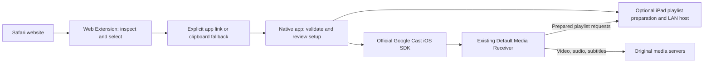

# Universal VidCaster: architecture decision executive summary

Date: 2026-10-25. Status: retrospective summary of the implemented architecture.
This consolidates the decisions and their rationale; it is not a claim that each
choice was recorded as a formal ADR before implementation.

## Executive overview

Universal VidCaster helps a user find video in Safari and play it on an existing
Google Cast TV, with playback controlled from an iPad. The architecture uses a
Safari Web Extension for media acquisition and a native SwiftUI app for casting,
playlist preparation, and session ownership. The TV downloads actual media from
its source servers; the iPad temporarily hosts prepared playlists when required.

This division follows the capabilities demonstrated during development. Safari
inspection worked, but inspection and native messaging did not establish a
supported Safari Cast sender. The native iOS Cast SDK provided the sender path
that was subsequently tested on the user's iPad and TV. The native app enables
a Mac-free local playlist host without a cloud service or a project-specific
receiver application. The user later reported normal several-hour movie playback
after backgrounding the iPad app.

## Architecture at a glance

Direct media skips playlist preparation. Import fills setup; an explicit native
Cast action starts playback. Preparation is neither screen mirroring nor video
transcoding.

## Technology choices and business rationale

| Technology | Role and reason for choosing it | Tradeoff |
| --- | --- | --- |
| Swift + SwiftUI, iPadOS 17+ | Native app, adaptive tablet UI, lifecycle integration, and direct access to the iOS Cast SDK. Fits the actual iPad-first target. | Apple-platform implementation; future Android support needs separate platform work. |
| UIKit bridge | Embeds Google's official Cast device-picker button in SwiftUI and manages screen-awake behavior. | A small platform-specific integration layer remains necessary. |
| Google Cast iOS SDK 4.8.6, pinned through Swift Package Manager | Supplies discovery, selection, session management, and media commands without implementing Cast transport ourselves. Exact pin keeps dependency behavior reproducible. | SDK/platform compatibility and receiver behavior remain external constraints; upgrades need validation. |
| Google Default Media Receiver | Uses the TV's existing Cast support; avoids developing and registering a custom receiver for the current scope. | Cannot assume arbitrary webpage rendering, custom request handling, or every media format. |
| TypeScript + standard HTML/CSS/DOM APIs | Shared Safari inspection and transfer UI, typed payloads, redaction, and reusable browser-side detection. No additional UI framework is needed for a small popup. | Browser visibility/permissions limit discovery; provider-specific matching needs maintenance. |
| Foundation + async/await | URL validation, bounded playlist fetch/preparation, and asynchronous use cases. | Signed-link expiry and source authorization remain outside app ownership. |
| Apple Network framework | Small, bounded LAN HTTP server for in-memory prepared playlists. Avoids adding a general server framework or cloud runtime. | App availability and local-network reachability constrain serving. |
| Combine + observable session model | Bridges service events into settled UI snapshots and injectable contracts using Apple's existing frameworks. | Requires disciplined lifecycle and event ownership. |
| Vite, npm workspaces, Node.js | Builds TypeScript extension resources and the desktop Chrome harness with one JavaScript dependency/build workflow. Node 24 is selected by `.nvmrc`. | Build-time tooling only; Node is not an iPad runtime dependency. |
| Vitest/jsdom and XCTest via Swift Package Manager | Tests browser collection/privacy and native validation/session/hosting logic without a physical TV for every check. | Doubles and loopback tests cannot prove TV playback, hardware buttons, or Safari app-opening behavior. |
| Xcode asset catalogs and manifest icons | Package native appearance variants and Safari toolbar artwork through their platform mechanisms. | Final appearance still needs device review. |

## Key decisions

### ADR-01: Split Safari acquisition from native casting

Safari owns access to the permitted webpage; the native app owns discovery,
receiver sessions, playback controls, and playlist serving. This keeps Cast
state out of the extension's short-lived popup and avoids assuming browser
inspection implies casting capability. The reviewed macOS transport experiments
remain supporting history, not the production iPad dependency.

### ADR-02: Prefer native iPad implementation over a cross-platform shell

SwiftUI was selected for the demonstrated target and its native SDK/lifecycle
integration. Flutter was discussed but not implemented or benchmarked. It would
still require Apple's build/signing tools and native integration for these
capabilities, so cross-platform UI reuse was not sufficient reason to add it at
this stage. This is a scope choice, not a general judgment against Flutter.

### ADR-03: Prepare playlists locally; let the TV fetch media

The observed website exposed signed master playlists whose child references
omitted session parameters that its player supplied. Preparation preserves
existing query values and adds missing supplied `t`/`pm` parameters. A temporary
iPad host serves the resulting playlist graph while media stays on source servers.

This removed the Mac dependency from the validated path and avoided cloud hosting
costs and server-side handling of private media links. The first Mac bridge was
a useful diagnostic baseline, not a requirement for current iPad operation.
The implementation does not generate credentials, renew tokens, transfer cookies,
or handle DRM. It supports a bounded finite VOD graph rather than universal HLS.

### ADR-04: Bound local hosting and record background playback separately

The user revised the original Safari-only preference and accepted a native app
for local playlist preparation. The user later reported a movie playing normally
for several hours with the app backgrounded. The TV fetches media from source
servers, so this observation does not prove continuous iPad playlist serving.
Local host sessions are configured to expire after 30 minutes; upstream
credentials can expire earlier. Host reachability after suspension or expiry,
longer hosting sessions, and recovery require separate evidence.

### ADR-05: Make UI designs replaceable without replacing session logic

The app root owns one `WorkspaceSession`. Replaceable screens call its actions
and render state; injectable `WorkspaceCastClient` and `WorkspaceHostClient`
contracts isolate SDK and hosting implementations. Tokens and reusable components
hold visual choices. This makes redesigns cheaper and permits fake-service previews
without initializing Cast or networking. It is source-level separation, not a
runtime theme plug-in system.

### ADR-06: Use explicit handoff with validation and a fallback

The Safari popup offers Open in Universal VidCaster; the native URL handler
validates the bounded transfer before replacing setup. Copy/Paste remains usable
if opening is canceled or unavailable. Neither route automatically casts or
interrupts existing playback.

The app link carries encoded original media URLs in its fragment. Encoding is
not encryption and a custom scheme is not an authenticated/exclusive channel.
The application does not log or persist the link, but OS handling is outside its
control. An opaque identifier backed by a shared native store is a possible
future hardening option. Redacted reports remain separate from playable inputs.

### ADR-07: Trust receiver state and distinguish control layers

An acknowledged request is not proof of visible playback. Controls and statuses
follow receiver callbacks/capabilities, with tracked failures and timeouts. Media
Stop, Disconnect, and clearing local hosting have distinct effects; End casting
coordinates them and reports partial outcomes.

The current volume design intentionally separates media and device audio:
the on-screen slider/mute controls the media stream, while the SDK option routes
physical iPad volume buttons to device volume on the user-tested setup. Each
new load requests 100% unmuted stream audio after load acknowledgement, preserving
device level/mute. Hardware-button success is a local physical finding; Google's
documented iOS limitations prevent a universal support claim.

## What this architecture does not include

No production cloud backend, account system, media database, transcoding service,
custom TV installation, arbitrary webpage browser on the receiver, screen mirror,
or virtual display is required by the current product. Mac extended-display and
whole-webpage streaming ideas are separate feasibility projects with different
capture, encoding, and latency requirements.

## Evidence and next decisions

The user confirmed native playback/controls, iPad-local website video/audio/subtitles,
Safari app-opening/import, speed/media volume, and physical-button device volume
on the tested setup. The user also reported normal several-hour movie playback
with the app backgrounded, without playlist-server telemetry. Latest recorded
software checks include 88 web tests and
34 native tests, plus successful iPad builds; those are development checkpoints,
not independent compatibility certification. Icon packaging passed; final visual
appearance still needs device review.

The main remaining decisions concern host lifetime/expired-link recovery,
network-loss behavior, subtitle acquisition across more players, handoff hardening,
and broader OS/TV/accessibility validation. These should be driven by observed
failures and product requirements before expanding the platform or receiver scope.

Supporting records: [native architecture](NATIVE_APP_ARCHITECTURE.md),
[Safari handoff](IPAD_SAFARI_HANDOFF.md), [volume decisions](CAST_SPEED_VOLUME.md),
[Mac-free feasibility history](MAC_FREE_IPAD_FEASIBILITY.md),
[Safari sender feasibility history](M2_SAFARI_FEASIBILITY.md), and
[icon integration](IconResources/README.md).
