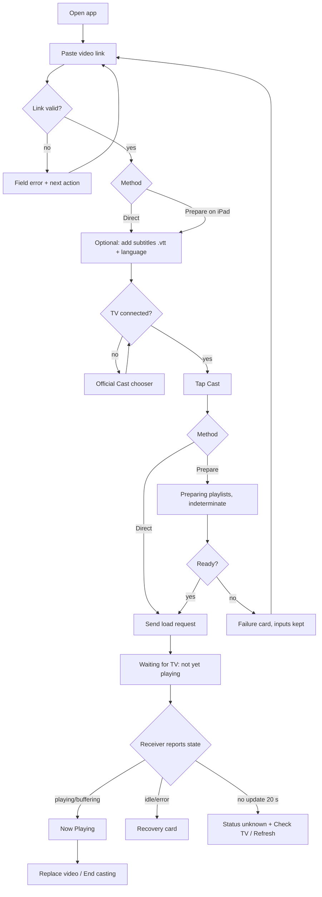

# Universal VidCaster: native iPad design specification

Implementation update (2026-10-23): adopted in the native app with the existing
Cast/hosting services. See [integration notes](INTEGRATION_NOTES.md) for actual
scope, corrections, checks, and pending physical review. The original proposal
and reference Swift scaffold below are historical design inputs, not the app's
compiled implementation or current feature-status checklist.

Status: design proposal, 2026-10-23. Nothing here has been implemented or tested on a TV. Every item is labeled **[Reuse]** (existing behavior), **[New]** (needs implementation) or **[Future]** (deferred). Mock data only; no real signed URLs appear anywhere.

---

## 0. Design summary

1. **One workspace, two zones.** *Setup* (what to cast) and *Now Playing* (watching and controlling). On an 11-inch iPad in landscape they sit side by side; in portrait and narrow windows they collapse to one column with a persistent mini player.
2. **A session strip replaces the single green dot.** Three independently labeled statuses: **TV** (connection), **iPad** (hosting) and **Playback** (receiver truth). Each has an icon, a word and a color, so none relies on color alone.
3. **The normal path has four visible things:** paste link, (optional) subtitles, TV, Cast button. MIME, fMP4, live, presets, refresh and logs live under **Advanced** and **Diagnostics**.
4. **Honest verbs.** Four distinct actions, never interchangeable: *Stop playback*, *Disconnect TV*, *Stop sharing from this iPad* (clears hosting), and the composite *End casting* **[New]**.
5. **Nothing is claimed that the receiver has not reported.** "Sent to TV" is not "Playing".

---

## 1. Visual direction

Calm, dark-leaning media tool that also looks right in light mode. Large rounded surfaces, one accent, generous spacing. No invented library, thumbnails or dashboards.

### 1.1 Color tokens (SwiftUI asset-catalog names)

| Token | Light | Dark | Use |
| --- | --- | --- | --- |
| `bg.canvas` | #F4F5F8 | #0E1014 | Window background |
| `bg.surface` | #FFFFFF | #181B22 | Cards |
| `bg.surfaceRaised` | #EEF0F5 | #222631 | Fields, segmented tracks |
| `stroke.subtle` | #D9DCE5 | #2D3240 | Card and field borders |
| `text.primary` | #14161C | #F2F4F8 | Body, titles |
| `text.secondary` | #4F5565 | #A9AFBF | Helper text (min 4.5:1 on surface) |
| `accent` | #3F4FD0 | #93A0FF | Primary button, focus, selection |
| `accent.onAccent` | #FFFFFF | #0E1014 | Text on accent |
| `status.ok` | #1B7F46 | #5FD08C | Confirmed by receiver |
| `status.progress` | #8A5A00 | #FFC857 | Working, buffering |
| `status.warn` | #8A5A00 | #FFC857 | Needs attention |
| `status.error` | #B3261E | #FF8A80 | Failed |
| `status.unknown` | #5A6072 | #98A0B4 | Stale or unconfirmed |

Prefer system semantic colors where they match. All text/background pairs must meet WCAG AA. Status pills always pair color with an SF Symbol and a text label.

### 1.2 Typography (SF Pro, Dynamic Type; never fixed sizes)

| Role | Style | Notes |
| --- | --- | --- |
| Screen title | `.largeTitle` bold | Collapses on scroll |
| Card heading | `.title3` semibold | |
| Field label | `.subheadline` semibold | Above the field, never placeholder-only |
| Body / helper | `.body` / `.footnote` | Helper text may wrap freely |
| Transport time | `.title2` monospaced digits | `monospacedDigit()` |
| Diagnostics | `.caption` monospaced | |

At accessibility sizes (AX1 and above): session strip becomes a vertical list, transport row wraps to two rows, side-by-side layout collapses to one column.

### 1.3 Spacing, shape, controls

- 4 pt grid. Card padding 20, gap between cards 16, field height min 48, touch targets min 44x44 (transport buttons 64x64).
- Card radius 20; field radius 12; primary button full-width capsule, 56 tall.
- Primary button: filled `accent`. Secondary: tinted. Destructive: `.role(.destructive)` with red text, never filled red except confirmation dialogs.
- Focus: 3 pt `accent` ring (keyboard/Pointer). Selection: filled segment plus checkmark glyph. Disabled: 40% opacity plus helper text saying *why*.
- Icons (SF Symbols): `tv`, `wifi`, `externaldrive.connected.to.line.below` (hosting), `play.fill`, `pause.fill`, `stop.fill`, `captions.bubble`, `link`, `doc.on.clipboard`, `exclamationmark.triangle`, `arrow.clockwise`. The Cast button is the official `GCUICastButton`; do not restyle beyond tint.

---

## 2. Information architecture

```
Universal VidCaster
├─ Setup zone  (NavigationSplitView sidebar / top of single column)
│   ├─ 1 Video link  (Paste, title, start time, method)
│   ├─ 2 Subtitles   (optional, collapsed)
│   ├─ 3 TV          (Cast button, permission/no-device states)
│   ├─ Cast button   (primary action)
│   └─ Advanced      (MIME, fMP4, live, presets)  [Reuse, relocated]
├─ Now Playing zone (detail / full-screen cover / mini player)
│   ├─ Header: title, TV name
│   ├─ Session strip: TV · iPad · Playback
│   ├─ Transport: seek, play/pause, stop, subtitles On/Off [New]
│   ├─ Foreground notice (iPad mode)
│   └─ Session menu: End casting, Stop sharing, Disconnect
└─ Diagnostics (sheet from ••• menu): bounded log, receiver observations, refresh
```

### 2.1 Primary flow



---

## 3. Screens (annotated wireframes)

### 3.1 Setup, landscape 11" (about 1194 x 834 pt)

```
┌───────────────────────────────────────────────────────────────────────────┐
│ Universal VidCaster                                  [Cast icon] ••• (menu)│
├──────────────────────────────┬────────────────────────────────────────────┤
│ SETUP                        │  NOW PLAYING                               │
│ ┌──────────────────────────┐ │  ┌──────────────────────────────────────┐  │
│ │ 1  Video link            │ │  │          (empty state)               │  │
│ │ [ https://…        ][Paste]│ │  │   📺  Nothing is casting yet        │  │
│ │ Title (optional)         │ │  │   Paste a video link on the left,   │  │
│ │ Start at  [ 0:00 ]       │ │  │   choose your TV, then tap Cast.    │  │
│ │ How to play it           │ │  │                                      │  │
│ │ (• Direct file) ( Prepare│ │  │   Where do I get a link?  ›         │  │
│ │   on this iPad)          │ │  └──────────────────────────────────────┘  │
│ │ help text               │ │                                            │
│ └──────────────────────────┘ │                                            │
│ ┌──────────────────────────┐ │                                            │
│ │ 2  Subtitles (optional)  ▸│ │                                            │
│ └──────────────────────────┘ │                                            │
│ ┌──────────────────────────┐ │                                            │
│ │ 3  TV     [Cast] Living… │ │                                            │
│ └──────────────────────────┘ │                                            │
│ [   Cast to Living Room TV  ]│                                            │
│ ▸ Advanced                   │                                            │
└──────────────────────────────┴────────────────────────────────────────────┘
```

Annotations
1. Sidebar width 380 pt fixed (resizable 340 to 420). Detail takes the rest.
2. **Paste** is an explicit button with `doc.on.clipboard`. The app never reads the clipboard at launch **[Reuse]**. The field is editable and multiline-capable (up to 3 lines, then scrolls). The full original URL including query is kept in memory only.
3. After a successful paste the field collapses to a **summary row**: `link  media.example.test · Prepared-stream link   [Edit]`. Signatures are never displayed outside the editable field. Tap Edit to reveal it.
4. **How to play it** is a two-segment control. See copy in section 5. The default is Direct. Selecting Prepare hides nothing else; MIME/fMP4/live are fixed automatically **[Reuse]**.
5. The Cast button is disabled until the link is valid; helper text under it says why ("Paste a video link to continue").
6. The right pane shows the empty state until a session exists; then it becomes Now Playing.

### 3.2 Setup, portrait

Single column in a `ScrollView`. Order: Video link, Subtitles, TV, primary button. The primary button is pinned in a bottom safe-area inset bar (`safeAreaInset(edge: .bottom)`) with material background so it never sits under the keyboard or home indicator. Once a session exists, a **mini player** (64 pt) docks above the button bar: `[tv] Living Room TV · Playing · 12:04 / 24:30 [pause]`; tapping it presents Now Playing as a full-screen cover.

### 3.3 Narrow/resizable window (Split View, Stage Manager, under about 600 pt)

`NavigationSplitView` collapses automatically: Setup is the root; Now Playing pushes when a session begins or the mini player is tapped. Rules:
- Session strip becomes a two-line vertical list.
- Transport buttons keep 64 pt targets; the seek bar spans full width with time labels below.
- Minimum supported width: 320 pt. Below about 400 pt the segmented "How to play it" becomes a vertical radio list.

### 3.4 Subtitles card (expanded)

```
┌──────────────────────────────────────────┐
│ 2  Subtitles (optional)                 ▾│
│ Subtitle link (.vtt)                      │
│ [ https://…                      ][Paste] │
│ Language    [ English (en)          ▾ ]   │
│ This link has its own access. The video   │
│ link’s access is not shared with it.      │
└──────────────────────────────────────────┘
```

- Collapsed by default; collapsed row shows "Off" or "English · media.example.test".
- Language picker: English (`en`), Indonesian (`id`), **Other…** (free-text BCP-47 code with validation). Never imply these are the only choices.
- Validation: must be `http(s)`, should look like WebVTT; non-`.vtt` extension gives a *warning*, not a block (type is determined by the server).
- When this card has a value and a session is already playing, the primary button changes to **Reload with subtitles** and shows the consequence line (see section 5).

### 3.5 TV card and permission integration

States (all inside card 3):

| State | Content |
| --- | --- |
| Before permission | Short explanation + **Allow Local Network Access** button that triggers the system prompt |
| Discovering | Spinner + "Looking for TVs on this Wi-Fi…" (indeterminate) |
| None found | `wifi.slash` + "No TV found" + checklist (same Wi-Fi, TV on, Cast built-in) + **Try again** |
| Permission denied | "Local Network access is off" + **Open Settings** |
| Found, not connected | Official **Cast button** + "Choose your TV" |
| Connected | TV name + status chip + Cast button (tap to change or disconnect) |

The system chooser (official SDK) is always the picker. A retained connection is reused on every load; the user is not asked to choose again **[Reuse]**.

### 3.6 Preparing (iPad mode only)

The primary button becomes a disabled progress button: `⟳ Preparing on this iPad…`. Below the form, a **Phase list** (no percentages, no fake bar):

```
✓ Link checked
⟳ Preparing playlists on this iPad…      (indeterminate)
○ Sending to Living Room TV
○ Waiting for the TV to start
```

- A phase shows ✓ only when it actually completed; "Waiting for the TV to start" completes only on a receiver status of buffering or playing.
- Duplicate Cast taps are disabled. **Cancel** is shown only if cancellation is implemented **[New: preparation cancellation]**; otherwise omit it.
- If the app becomes inactive here, show nothing intrusive; on return, show state per section 6.

### 3.7 Now Playing

```
┌────────────────────────────────────────────────────────────┐
│ ‹ Setup                                          •••       │
│ Episode 12 (title or “Untitled video”)                     │
│ Living Room TV                                             │
│                                                            │
│  TV: 🟢 Connected   iPad: ⏺ Sharing, 24 min left?   Play: ▶ Playing │
│  (strip, see 4)                                            │
│                                                            │
│  ┌ artwork placeholder: tv glyph on gradient, no preview ┐ │
│  └────────────────────────────────────────────────────────┘ │
│  12:04  ━━━━━━━━●━━━━━━━━━━━━━━━━━━━━━━━━━━  24:30         │
│       [⏪ 15]   [ ⏸ Pause ]   [⏩ 15]     [⏹ Stop]        │
│       [CC Subtitles: English  On ▾]  [New]                 │
│                                                            │
│  ⓘ Keep this app open and the screen on while casting.     │
│  [ Replace video ]               [ End casting ]           │
└────────────────────────────────────────────────────────────┘
```

Annotations
- **Artwork** is an honest placeholder (symbol on gradient). No fake thumbnail or title extraction.
- **Seek bar:** draggable slider replacing the numeric field. Enabled only when the receiver reports seek is supported and a duration is known; otherwise disabled with caption "Seeking isn't available for this video." Position updates arrive via receiver callbacks **[Reuse]**; smooth animation between callbacks (client-side interpolation while playing) is **[New]** and must snap to the next real update. Releasing the slider issues one seek; show "Seeking…" until confirmed.
- **±15 s** buttons are **[New]** convenience on top of the existing seek command.
- **Play/Pause:** a single toggle driven by actual media state; disabled while Buffering/Unknown with a caption.
- **Stop** stops TV media only and shows a confirmation toast "Stopped on TV. This iPad is still sharing." (iPad mode) **[Reuse behavior; copy New]**.
- **Subtitles On/Off** is shown only when a track was supplied at load; behavior depends on native command support **[New, needs validation]**. Until validated, ship it hidden.
- **Foreground notice** is a quiet inline info row (not a modal and not repeated) shown while hosting **[Reuse behavior]**.
- **Expiry:** a text-only "Sharing from this iPad ends at 4:12 PM" appears once the app exposes a structured expiry **[New]**. Without it, omit the line. Never display remaining token life.

---

## 4. Session strip (the three truths)

| Axis | Values (word + icon) | Source |
| --- | --- | --- |
| **TV** | Not connected · Connecting · Connected to {name} · Connection lost | Cast session state |
| **iPad** (hosting) | Not used (Direct) · Preparing · Sharing · Paused (app in background) · Ended (30 min limit) · Cleared | Host state |
| **Playback** | Idle · Sent to TV · Buffering · Playing · Paused · Stopped · Error · Unknown (stale) | Receiver status |

Rules
- Playback shows **Unknown** (gray) with the timestamp "Last update 2 min ago" whenever no fresh update arrived since returning to the app or after the 20 s tracking timeout.
- The iPad axis is hidden in Direct mode (replaced by "Direct: TV loads the video itself").
- No axis ever turns green because another axis is green. Only Playback shows `Playing` and only when the receiver says so.

---

## 5. Exact UI copy

**Primary actions**
- Paste button: `Paste`
- Primary (not connected): `Choose a TV to cast`
- Primary (ready, Direct): `Cast to {TV name}`
- Primary (ready, Prepare): `Prepare & cast to {TV name}`
- Primary (working): `Preparing on this iPad…` / `Sending to {TV name}…`
- Primary (session exists): `Replace video`

**Link section**
- Label: `Video link`
- Helper: `Paste a direct video file link or a stream link you copied from your browser. A website page address won't work.`
- Method segments: `Direct file` / `Prepare on this iPad`
- Direct help: `Your TV downloads the video straight from the link. Best for ordinary MP4 files.`
- Prepare help: `For streams that need a small preparation step. Your iPad shares the stream's playlists with your TV over Wi-Fi. The video itself still comes from the website.`
- Title field: `Title (optional)` · Start: `Start at (mm:ss)`
- Advanced header: `Advanced` · footer: `Only change these if a direct link won't play.`

**Validation / errors (field level)**
- Empty: `Paste a video link to continue.`
- Not a URL: `This doesn't look like a link. Copy the full video link and paste it again.`
- Redacted: `This link has hidden parts and can't play. Copy the original media link again.`
- Webpage not media: `This looks like a web page, not a video. Copy the video's own media link instead.`
- Start time: `Enter a time like 1:30.`
- Subtitle language: `Choose a language or enter a code like “en”.`
- Subtitle link: `Subtitles need a complete link ending in a .vtt file.`

**Permission context (before system prompt)**
- Title: `Find TVs on your Wi-Fi`
- Body: `To find your TV and share the stream with it, VidCaster needs access to devices on your local network. Nothing leaves your home network for this step.`
- Button: `Continue`
- After denial: `Local Network access is off. Turn it on in Settings to find your TV.` · button `Open Settings`

**No device**
- `No TV found. Check that your TV is on, uses Google Cast, and is on the same Wi-Fi as this iPad.` · `Try again`

**Foreground hosting (persistent, quiet)**
- Pre-cast, under the primary button in Prepare mode: `Keep VidCaster open and the screen on while casting.`
- On Now Playing: `Keep this app open and the screen on. If you leave, playback may stop.`
- On return from background: `Welcome back. Checking your TV…` then actual state.

**Preparation failure** (inputs retained)
- `Couldn't prepare this video. The link may have expired, the site may have refused it, the network may have dropped, or this video type isn't supported. Copy a fresh original link from the website and try again.` · buttons `Edit link`, `Try again`
- No promise of automatic renewal.

**Load sent / unknown**
- `Sent to your TV. Waiting for it to start…`
- After 20 s: `No update from the TV yet. It may still be starting. Check your TV, or tap Refresh.` · `Refresh status`

**Receiver idle/error**
- `Your TV stopped playing this video. Try again, or prepare a fresh link.`

**Subtitles**
- Section helper: `Subtitles have their own access. The video link's access isn't shared with them.`
- Configured chip: `Subtitles set · English`
- Active state: `Captions on` only if receiver reports the track active; otherwise `Subtitles loaded, not confirmed on screen.`
- Track failure: `Couldn't load subtitles. The video can still play. Check the subtitle link and language.`
- Replace-while-playing confirm: `Changing subtitles restarts the video from the current position. Continue?` · `Restart with subtitles` / `Cancel`

**Expiry / host ended**
- `Sharing from this iPad ended after 30 minutes. Your TV may stop at the next chunk. Prepare the video again to keep watching.` · `Prepare again`
- (If expiry time shown) `Sharing ends at {time}.`

**Replacement**
- Confirm: `Replace the current video? The current one will stop sharing from this iPad as soon as the new one is ready. It can't be resumed.` · `Replace` / `Keep watching`

**Ending a session** (menu with explanations)
- `Stop playback` — `Stops the video on your TV. Your TV stays connected.`
- `Disconnect TV` — `Disconnects from your TV. The video may keep playing, and this iPad keeps sharing until you stop it.`
- `Stop sharing from this iPad` — `Removes the prepared stream from this iPad. Your TV may fail soon after.`
- `End casting` **[New composite]** — `Stops playback, stops sharing, and disconnects.`
- End casting confirm: `End casting to {TV name}? This stops the video, clears the prepared stream from this iPad, and disconnects.` · `End casting` (destructive) / `Cancel`
- Partial failure: `Casting ended, but the TV didn't confirm it stopped. Check your TV.`

**Disconnected but hosting retained**
- Banner: `Disconnected from your TV. The video may still be playing, and this iPad is still sharing. Reconnect to control it, or choose Stop sharing.`

---

## 6. State / action matrix

Legend: ✓ enabled, — disabled, ◐ conditional.

| State | Paste/edit inputs | Cast / Replace | Play/Pause | Seek | Stop | Disconnect | Stop sharing | End casting | Visible status |
| --- | --- | --- | --- | --- | --- | --- | --- | --- | --- |
| Empty | ✓ | — (reason shown) | — | — | — | — | — | — | Empty state |
| Invalid input | ✓ | — | — | — | — | — | — | — | Field error |
| No permission | ✓ | — | — | — | — | — | — | — | Permission card |
| Discovering / no TV | ✓ | — | — | — | — | — | — | — | Retry card |
| Connected, no video | ✓ | ✓ | — | — | — | ✓ | — | — | TV name |
| Preparing | locked (read-only) | — | — | — | — | ✓ | ◐ cancel [New] | — | Phase list |
| Sending load | locked | — | — | — | — | ✓ | ✓ | ✓ | "Sent to TV" |
| Buffering | ✓ | ✓ (confirm) | — | ◐ | ✓ | ✓ | ✓ | ✓ | Buffering |
| Playing / Paused | ✓ | ✓ (confirm) | ✓ | ◐ (if supported) | ✓ | ✓ | ✓ | ✓ | Receiver state |
| Load ack, status unknown | ✓ | ✓ (confirm) | — | — | ◐ | ✓ | ✓ | ✓ | Unknown + Refresh |
| Receiver idle/error | ✓ | ✓ | — | — | — | ✓ | ✓ | ✓ | Recovery card |
| App returns | ✓ | ✓ | — until fresh | — until fresh | ◐ | ✓ | ✓ | ✓ | Stale/Unknown + timestamp |
| Host expired/cleared | ✓ | ✓ (Prepare again) | per receiver | per receiver | ✓ | ✓ | — | ✓ | "Ended" |
| Disconnected, host retained | ✓ | — until reconnect | — | — | — | — | ✓ | ◐ [New] | Banner |

**Data surviving navigation/retry (memory only; nothing persisted):**
- Survives: pasted URL, title, start time, method, subtitle URL/language, advanced toggles, connected TV, last receiver status.
- Cleared on **End casting**, **Stop sharing** (host state only), and app termination.
- Inputs are retained after any failure and when the user goes back to Setup from Now Playing. Moving between Setup and Now Playing never stops playback or hosting; only the explicit actions above do.

**Action semantics (restated for implementers)**
- Play/Pause/Seek/Stop act on TV media. **[Reuse]**
- Stop does not clear hosting. **[Reuse]**
- Disconnect leaves TV playing and hosting retained. **[Reuse]**
- Stop sharing clears playlists/listener only. **[Reuse]**
- End casting composes Stop, then clear, then disconnect; each step's result is reported. **[New]**

---

## 7. Keyboard and layout behavior

- Use `ScrollViewReader` and `.scrollDismissesKeyboard(.interactively)`; focused field scrolls to just above the keyboard with its label and any error visible.
- Primary button lives in `safeAreaInset(.bottom)`; with the keyboard up it rides above it (never covered). Errors are rendered **inside** the card under the field, not only in a toast.
- URL fields: `.keyboardType(.URL)`, `.textInputAutocapitalization(.never)`, autocorrect off, `Return` = "Done".
- Start time uses a compact mm:ss field with `.numbersAndPunctuation`; provide a toolbar **Done** button because numeric pads lack Return.
- Hardware keyboard: Cmd-V pastes in the focused field; Cmd-Return triggers Cast when valid; Space toggles Play/Pause on Now Playing; Esc dismisses sheets.

---

## 8. Accessibility

- **VoiceOver order** (Setup): Video link field, Paste, Title, Start, How to play, Subtitles, TV, Cast button, Advanced. Now Playing: title, session strip (one grouped element: "TV connected to Living Room TV. iPad sharing. Playback playing."), seek slider, Play/Pause, Stop, subtitles, foreground notice, session menu.
- Seek slider: `accessibilityValue("12 minutes 4 seconds of 24 minutes 30 seconds")`, adjustable with ±15 s increments.
- Status changes (e.g., "Playing", "No update from TV") announced with `AccessibilityNotification.Announcement`; don't announce position ticks.
- Every status uses icon + text + color. Errors also include the `exclamationmark.triangle` glyph and the word "Error" or "Problem".
- Support Dynamic Type through AX5, Bold Text, Increase Contrast, Reduce Motion (no interpolated animation, snap updates), Reduce Transparency (solid bottom bar), Voice Control labels matching visible text, and Full Keyboard Access.
- Do not put signatures in accessibility labels either. URL summaries read as "Video link from media.example.test, prepared stream".
- Target sizes 44x44 minimum; transport 64x64.
- Light/dark checks for every token pair; contrast verified on `bg.surface` and `bg.surfaceRaised`.

---

## 9. Privacy and logging rules (design-enforced)

- Full URLs appear only in the editable field. Card summaries, toasts, status text, diagnostics and screenshots show host plus a neutral label.
- Mock screenshots use only the safe sample data from the handover (flower.mp4, `media.example.test`, `EXAMPLE` tokens).
- Diagnostics log is bounded, omits URLs, and has a **Copy diagnostics** action that warns: `This report doesn't include links, but may include your TV's name.`
- No history, favorites, sign-in or analytics. No persistence of inputs.

---

## 10. Behavior inventory

### 10.1 Existing behavior reused **[Reuse]**
- Official Cast chooser, retained connection, Local Network explanation.
- Direct load and prepare-on-iPad load; auto HLS/fMP4/on-demand in iPad mode.
- Play, Pause, Stop, numeric-position seek command, Disconnect, Refresh receiver status.
- Hosting 30-minute limit, auto-lock disabled while hosting, Stop-sharing-and-clear, replacement after successful preparation.
- 20-second tracking timeout with "unknown outcome" semantics.
- Bounded diagnostics log without media URLs; input validation; limits (32 playlists, depth 4, 1 MiB each, 8 MiB total) shown only in diagnostics/help.

### 10.2 New behavior to implement **[New]**
1. Split-view workspace, mini player, session strip with three axes.
2. Seek slider UI over the existing seek command; ±15 s buttons.
3. Interpolated progress timeline between receiver callbacks (optional, must snap to truth).
4. Structured hosting **expiry value** for "ends at {time}" text.
5. **End casting** composite with per-step result reporting.
6. Cancellation of preparation (if wanted) and preparing-before-connection (current code requires a connected TV). Flag as behavior change.
7. Subtitle casting: attach one WebVTT track at load (direct and iPad modes), language selection, track-failure messaging separate from video authorization failures, "Subtitles loaded vs captions confirmed" distinction.
8. In-session subtitles Off/On via native track command; replacement via reload with the consequence confirmation. Needs real-receiver validation before shipping.
9. Link-kind classification (direct file vs stream) to suggest a method. Treat as a **new dependency**; until built, the user picks the method and `.json` is never assumed HLS from the extension.
10. Replace-video confirmation dialog and disconnected-but-hosting banner.
11. Updated copy removing the outdated Mac-bridge text; move Mac presets to a hidden testing area or remove.

### 10.3 Future / deferred **[Future]**
- Safari extension handoff and automatic link or subtitle discovery.
- Background or lock-screen continuity, token renewal, countdown tied to real token life.
- Subtitle search/download, auto-translation, SRT conversion, timing offsets, multiple tracks.
- Link history, favorites, sign-in, analytics, thumbnails, title extraction.
- Live or encrypted streams.

---

## 11. Implementation notes for the existing SwiftUI app

- Replace the single `Form` with `NavigationSplitView` (sidebar: Setup; detail: Now Playing). On compact width it collapses automatically.
- One `@Observable` session model exposing three separate enums (`tv`, `host`, `playback`) plus `lastStatusDate`; the strip reads only from them.
- Keep the Cast button as a `UIViewRepresentable` wrapper around `GCUICastButton`.
- Disclosure groups for Subtitles and Advanced; presets and logs move into a Diagnostics sheet.
- Increment plan: (1) restructure UI with existing behavior, (2) session strip and copy, (3) seek slider and End casting, (4) subtitles at load, (5) in-session subtitle toggle after validation.

---

## 12. Usability-test checklist

First-time user, iPad M1 11", portrait and landscape, light and dark:
1. Without help, can they find Paste, choose the TV and start casting?
2. Do they understand the difference between a webpage address and a media link?
3. Do they notice and comply with the keep-open/screen-on notice before starting?
4. During preparation, can they say what is happening and that the video isn't playing yet?
5. Can they tell Stop, Disconnect and Stop sharing apart? Ask what each does before and after.
6. After leaving for Safari and returning, do they see stale/unknown status rather than a false "Playing"?
7. Expired link: do they know to copy a fresh link from the website?
8. Subtitles: can they add a `.vtt` link without blocking video-only use? Do they understand replacing them restarts playback?
9. Keyboard: does the Cast button and the field error remain visible with the keyboard up?
10. Narrow window (Split View about 1/3) and Dynamic Type AX3: nothing clipped or unreachable.
11. VoiceOver pass for the full flow; Reduce Motion and Increase Contrast pass.
12. Confirm no signed URL appears in any message, summary, log or screenshot.
