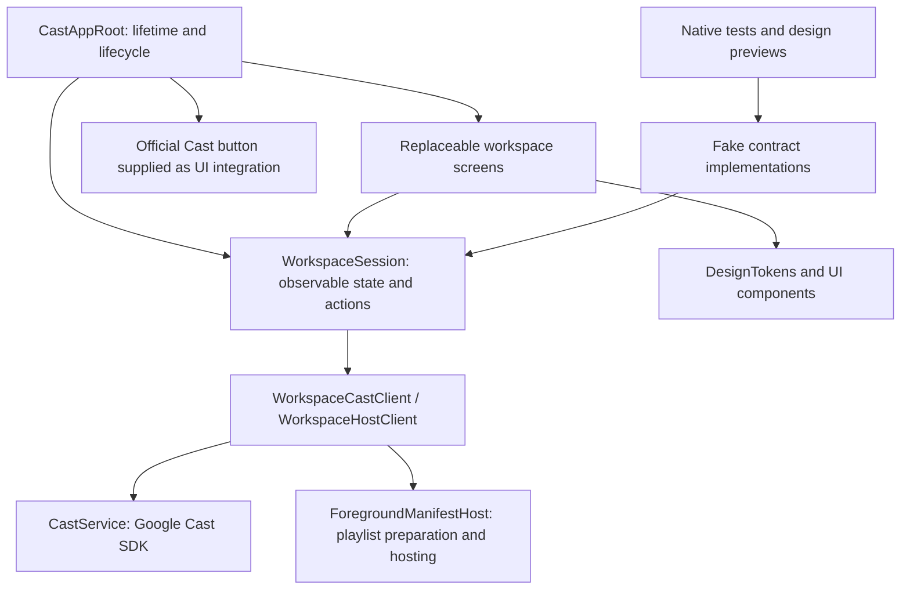

# Native app architecture and future design swaps

Updated 2026-10-23. The user confirmed the redesigned UI checks worked and asked
that later designs be easy to replace. Session behavior now lives outside the
screens, behind injectable service contracts.

The user subsequently confirmed all architecture-refactor smoke-test functions
worked. A new explicit Safari transfer is added through `SafariHandoff.swift`
validation and `WorkspaceSession.importSafariTransfer(_:)`, separate from visual
components and media preparation. The embedded extension has no Cast SDK/session
owner. Its physical iPad handoff test remains pending; see
[handoff guide](IPAD_SAFARI_HANDOFF.md).



## Responsibilities

| File | Responsibility | When a design changes |
| --- | --- | --- |
| `NativeCastApp.swift` | App/SDK startup, single session ownership, app lifecycle, actual Cast button | Keep stable; change only selected root screen |
| `WorkspaceSession.swift` | Draft, state snapshots, validation, load/prepare, seek, End casting, lifecycle coordination; service contracts | Reuse; no SwiftUI/UIKit/SDK import |
| `WorkspaceServices.swift` | Maps production services into those contracts | Keep stable unless service behavior changes |
| `CastWorkspaceView.swift` | Layout, navigation, sheets, confirmations, view-only state | Replace or rearrange freely using the same model |
| `WorkspaceSetupView.swift` | Input/setup/primary-action rendering | Design work |
| `WorkspacePlayerView.swift` | Player, transport, session statuses/actions | Design work |
| `WorkspaceDiagnosticsView.swift` | Diagnostics and testing presets | Design work |
| `WorkspaceComponents.swift` | Shared editable/private link fields and view helpers | Design work |
| `DesignTokens.swift` | Colors, spacing, shapes, styling components, display formatting | Theme/component work |
| `WorkspacePreviews.swift` | Debug-only fake services for setup/playing previews | Add visual scenarios without SDK/network |
| `PlaybackDraft.swift`, `MediaInput.swift` | Validation and MIME rules | Reuse; test changes independently |
| Cast/manifest/server services | Real transport, receiver truth, token handling, serving, expiry | Keep unchanged for a visual redesign |

The screen files currently use extensions of one workspace view to share its
local navigation/editing state. This is a small presentation layer, not an
independent feature-framework or runtime theme plug-in system. Future screens
can also be separate SwiftUI view types taking the same session model.

## Stable UI entry point

The production composition root constructs one WorkspaceSession with real
CastService and ForegroundManifestHost dependencies. It passes the observable
session and an official device-picker view into the selected workspace:

```swift
CastWorkspaceView(session: session, devicePicker: AnyView(CastButton()))
```

To adopt a new design:

1. For colors/spacing only, edit DesignTokens. Avoid changing services or validation.
2. For layouts, update presentation files or create `NewWorkspaceView` accepting
   `WorkspaceSession` and a `devicePicker: AnyView`.
3. Change the view selected by CastAppRoot; leave its StateObject ownership and
   app lifecycle forwarding intact. Never construct services in a screen body,
   navigation destination, sheet, or token/theme object.
4. Bind forms through `$session.draft`. Render `session.cast`, `session.host`, and
   derived state. Use model actions rather than reaching into real services.
5. Keep edit visibility, focus, sheets, confirmation dialogs, and slider-drag state
   in views. Session state and async operations belong in WorkspaceSession.
6. Preview with the fake clients first, run the native tests, then smoke-test the
   chosen UI on the iPad and TV. A screen swap must not clear a host or disconnect.

Navigation is intentionally presentation-owned. Recreating a screen may reset its
editing/sheet state, but it does not recreate the root session, lose the draft,
discard hosting, or end playback. No persistence beyond app lifetime is added.

## Model surface

- State: `draft`, read-only `cast` and `host` snapshots, `error`, `preparing`,
  `ending`, `isActive`, subtitle configuration, and End casting result.
- Derived: `working`, `canSeek`, `sessionExists`, `playerTitle`, `playbackLabel`.
- Actions: `validateDraft()`, `load()`, `control(_:)`, `seek(to:)`, `skip(_:)`,
  `disconnect()`, `clearHosting()`, `endCasting()`, and testing presets.
- Lifecycle: only the composition root calls `setActive(_:)`.

The model observes production changes through Combine and publishes settled
snapshots; SDK receiver callbacks remain authoritative. Neither load completion,
End casting, nor a screen can fabricate Playing, Idle, or disconnected state.
Views still own confirmation UX before explicit replacement/clear/end actions.

## Preview and testing boundaries

`WorkspacePreviews.swift` supplies fake clients and a placeholder TV button; it
does not initialize the Cast SDK, fetch URLs, or open a playlist listener. Sample
URLs use reserved example domains. Fake actions are for design preview only and
are never selected by the production composition root.

Session tests use the same contracts and verify independent behavior:
direct load/subtitle preservation, iPad preparation and generated URLs, failure
input retention, duplicate load protection, app-inactive load blocking, receiver
updates, bounded seeks, and partial End casting without false state changes.
These tests have no SwiftUI or Google Cast dependency.

Verification: 26 native tests pass, including seven session-contract tests; the
final unsigned iOS build and whitespace check pass. No real TV was commanded
during the architecture tests. Device smoke validation after this refactor is pending.

Run `xcrun swift test --package-path spikes/ipad-cast` with full Xcode selected,
then build the iPad target. Physical UI/playback checks remain necessary after a
design swap. The pre-refactor UI was user-confirmed; the architecture refactor
is automatically checked and still needs a device smoke test.
